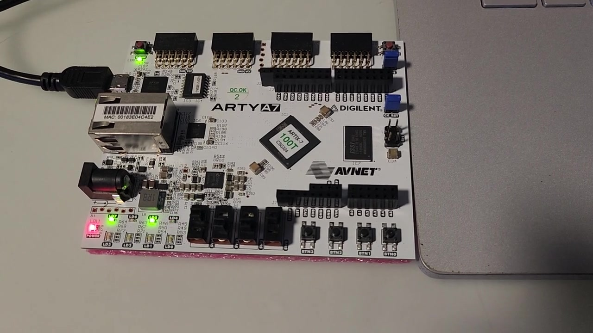
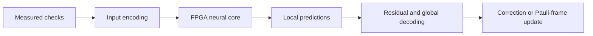

# FPGA neural decoders for quantum error correction

Verilog, SystemVerilog and Python code from my Master of Computer Science thesis at the University of Melbourne: **Resource-Constrained FPGA Implementations of Surface-Code Neural Decoders: Verification, Experimental Evaluation and Scalable Integration**.

The project asks how a neural decoder can fit on an FPGA, how much parallel computation helps, and what changes when the calculation is divided across several devices. It includes the 2D and 3D designs tested on an Arty A7-100T, together with larger resident and distributed designs used in simulation.

<p align="center">
  
</p>

The board used for the hardware experiments. [Short demonstration clip](docs/assets/arty-board-demo.mp4), recorded during an earlier distance-five implementation. The clip illustrates the setup; the numerical results are documented separately.

## Start here

- [Arty designs and build instructions](docs/arty-designs.md): memory-based 2D and 3D cores, board interfaces and small simulation examples.
- [Resident and distributed designs](docs/scalable-designs.md): overlapping layers, tile ownership and simulated communication.
- [Results and their scope](docs/results.md): board measurements, simulated completion times and internal timing checks on larger devices.
- [Quantum experiments and decoder comparisons](docs/quantum-experiments.md): IBM circuits, saved-data decoding, CNN/HDRG/MWPM simulations, pruning and decay fits.
- [Architecture estimates](docs/architecture-model.md): resource and communication models for larger FPGA systems.
- [Model and source attribution](ATTRIBUTION.md): the research behind the networks and the included coefficient files.

The small examples exercise the packaged HDL without an FPGA board. The HDL launchers use Python 3.10 or later and the standard library, and stage inputs under `build/`. The software decoder package has separate dependencies listed in its guide.

With Vivado's simulator on `PATH`:

```sh
python scripts/simulate_arty.py 2d
python scripts/simulate_arty.py 3d
```

With Icarus Verilog's `iverilog` and `vvp` on `PATH`:

```sh
python scripts/simulate_scalable.py resident
```

The distributed example uses Verilator, CMake and a C++20 compiler:

```sh
python scripts/simulate_scalable.py distributed
```

Each command compares the RTL with stored integer-reference results and reports a pass or failure. The scalable examples may take several minutes. The design guides explain tool-path options, input formats and additional checks. Building a board bitstream additionally requires Vivado with Artix-7 device support.

## What is implemented?

| Design | Main idea | Verification in the thesis |
|---|---|---|
| [Arty 2D](rtl/arty_2d/) | Share convolution arithmetic and read several memory banks in parallel | Physical Arty tests through code distance 33 |
| [Arty 3D](rtl/arty_3d/) | Include measurement history and start a layer when its inputs are ready | Physical distance-five tests, plus larger finite-volume simulations |
| [Resident 2D](rtl/resident_2d/) | Keep data on the device and overlap successive convolution layers | RTL simulations through distance 97; selected distance-33 internal timing on VP1902 |
| [Distributed 2D](rtl/distributed_2d/) | Assign each output to one worker and exchange the neighbouring values it needs | Simulated networks through distance 65 and up to 64 workers |

These cores produce local neural predictions. A complete quantum error-correction system also needs residual construction, a global decoder such as MWPM or HDRG, and a quantum-controller interface. Those stages are not implemented by the HDL in this repository.



The Python package implements input encoding, residual construction and global decoding for offline comparisons. IBM measurements are collected and decoded separately. The repository does not claim a live FPGA-to-QPU feedback demonstration.

For a small software comparison:

```sh
python -m pip install -r requirements-analysis.txt
python -m qec.simulate_2d --distances 3 5 --shots 128 --output build/spatial
python -m unittest discover -s tests -p test_qec.py -v
```

The IBM circuit commands build locally unless `--submit` is explicitly supplied. Credentials and measurement files stay outside the published source.

## Repository layout

```text
rtl/          Convolution engines, memories and worker control
boards/       Arty top-level modules and pin/clock constraints
models/       Floating-point and integer model parameters
qec/          Geometry, software decoders, IBM circuits and analysis
examples/     Small inputs, expected outputs and testbenches
scripts/      Portable simulation and build entry points
tests/        Offline numerical, circuit and board-protocol checks
targets/      Selected larger-device components and constraints
results/      Selected thesis results in CSV form
docs/         Design notes, results and figures
```

The resident and distributed folders contain some identically named modules with different interfaces. The launchers select the relevant source files; do not compile every file under `rtl/` into one design. The large files under `rtl/hardwired_2d/` are generated fixed-coefficient arithmetic, shared by the scalable designs.

## Reading the results

More parallel workers help when there is enough communication capacity to feed them. With a fixed total bandwidth, extra workers can exchange so much overlapping data that completion becomes slower. Memory layout, arithmetic, clock timing and communication therefore have to be considered together.

The repository distinguishes physical board measurements, digital simulations and internal implementation timing. A passing simulation is not a physical multi-board demonstration. The small packaged tests are convenient examples, not replacements for the thesis's full experiments.

## Attribution and citation

The neural models build on work by Spiro Gicev, Lloyd C. L. Hollenberg and Muhammad Usman. See [ATTRIBUTION.md](ATTRIBUTION.md) for the papers and a description of the parameter exports. Please cite the original model papers as well as this implementation where relevant. GitHub's citation menu uses [CITATION.cff](CITATION.cff).

**Author:** Mohit Garg, University of Melbourne.

**Supervisors:** Dr. Lloyd C. L. Hollenberg, Dr. Rajkumar Buyya and Dr Spiro Gicev.
