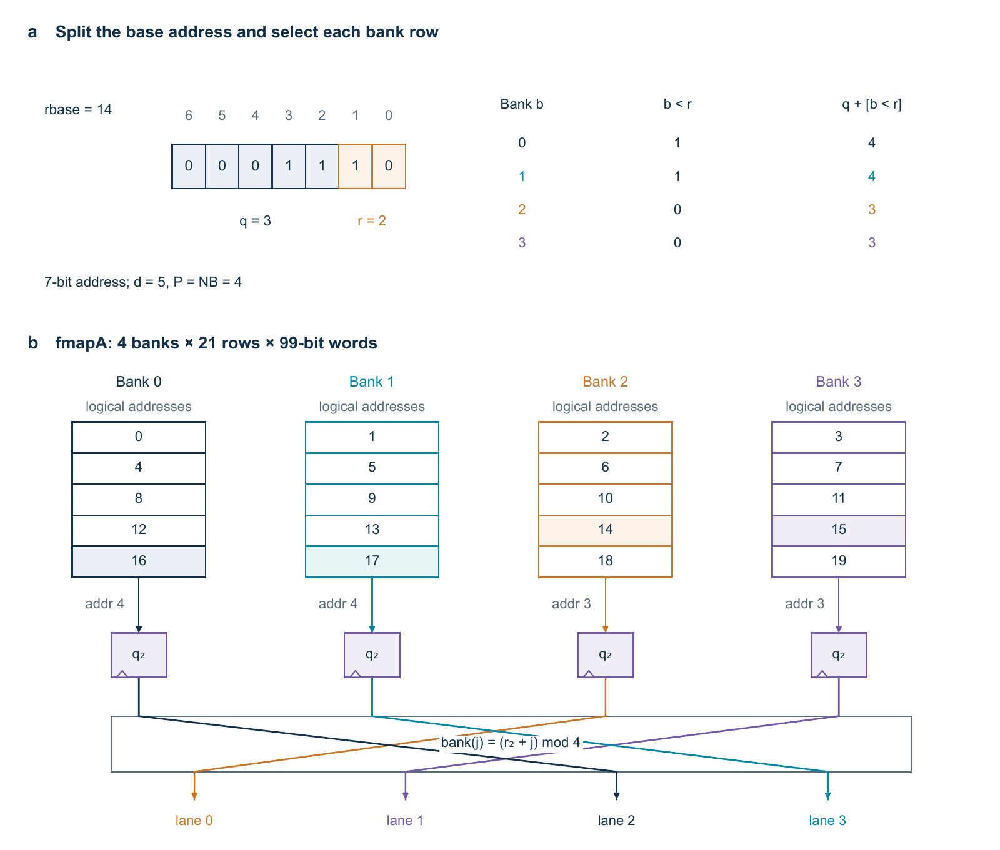

# Arty A7 implementations

The Arty A7-100T implementations reuse arithmetic hardware across a stored input. The 2D core processes a spatial map. The 3D core also processes measurement history. Both produce local CNN predictions; a complete decoder still needs to form the remaining syndrome and run the chosen global cleanup algorithm.

## What the folders contain

| Folder | Purpose |
|---|---|
| `rtl/arty_2d` | Three convolution layers, tap sequencers and banked memories |
| `rtl/arty_3d` | Four convolution layers, requantisation and finite-volume scheduling |
| `boards/arty/2d` | The 2D UART harness, pin constraints and 90 MHz clock wrapper |
| `boards/arty/3d` | The 3D UART harness, pin constraints and 95 MHz clock wrapper |
| `models` | Packed integer coefficients used by these implementations |
| `examples/arty_2d_d5` | One sparse input and expected values at every layer |
| `examples/arty_3d_d5` | One finite input volume and expected values at every layer |

The two board folders each contain their original UART modules. Compile one design at a time: the UART module names are intentionally the same.

## Two-dimensional core

Each of the three layers uses an 11 by 11 kernel. `P1`, `P2` and `P3` set how many kernel taps each layer processes per clock. They do not create separate clocks. The tested allocations are 11/4/6 and 11/6/6 taps.

The input has four binary channels on a `(2d-1)` by `(2d-1)` map, surrounded by a five-cell zero halo. Hidden layers have nine channels. Their memories store one copy of each map across banks, allowing consecutive taps to be read together. The bank count rounds up to a power of two; the tap count itself need not be a power of two.



*This illustration uses a nine-cell-wide map and four read lanes. Six-lane configurations use eight banks, with some banks unused by a given read group.*

The hidden layers retain 11-bit and 21-bit nonnegative activations. Raw sums use 16, 24 and 36 bits. The last layer writes two predictions per map location using `logit > 0`. These are the integer model's local outputs, not a complete logical-error correction by themselves.

Each layer has its own issue counter. A consumer waits until the preceding layer has written every location needed for its next output. Computation can therefore overlap across layers without reading unwritten data.

## Three-dimensional core

The finite input shape is `(d+1) × ((d+3)/2) × ((d+3)/2)` with twelve binary channels. At distance five this is six time planes of 4 by 4 locations: 96 input words. This encoded tensor layout is not a direct drawing of 96 physical qubits.

Four 3 by 3 by 3 convolution layers process the volume. The first three produce 128 channels. Hidden values are rounded, rescaled and clamped to eight bits. The last layer combines the hidden features with a skip connection from the original binary input, then writes twelve prediction bits per location.

`TCO_H=32` means that the two middle layers calculate 32 output channels per group. It does not mean 32-bit activations. The coefficient files in `models/3d/t32` are packed for this setting. Changing the parameter alone is insufficient: the weight words must be repacked for the new group size.

All three hidden volumes are stored in memory. This implementation handles a complete finite input, rather than accepting an indefinite live stream of quantum measurements. Its producer counters release a voxel only when every output-channel group has been written.

## Run the small checks

Install Vivado and put its `bin` directory on `PATH`. Python uses only the standard library for these two tests:

```text
python scripts/simulate_arty.py 2d
python scripts/simulate_arty.py 3d
```

Alternatively, supply `--tool-dir "<Vivado installation>/bin"`. Each command creates a new directory under `build/`; use `--output <new-directory>` to keep another run. Existing output directories are not overwritten.

The tests check every raw sum, hidden activation, prediction and synchronous output read against the included fixture. They also check the expected core cycle count: 4,377 clocks for 2D and 223,603 for 3D. The 3D test checks that consumers do not read a producer voxel before its complete write. These are short packaging checks, not a replacement for the larger thesis experiments. They do not exercise the UART or establish an FPGA clock frequency.

## Build a board configuration

The build script selects explicit presets rather than relying on historical module defaults:

| Preset | Distances | Core clock | Parallelism |
|---|---|---|---|
| `2d100` | 5, 9, 17, 25, 33 | 100 MHz | 11/4/6 taps, with 1/6 DSP lanes in the last two layers |
| `2d90` | 5, 33 | 90 MHz | 11/6/6 taps, with 2/4 DSP lanes |
| `3d95` | 5 | 95 MHz | 32 hidden output channels per group |

For example:

```text
vivado -mode batch -source scripts/build_arty.tcl -tclargs 2d100 5 rtl
vivado -mode batch -source scripts/build_arty.tcl -tclargs 2d90 33 synth
vivado -mode batch -source scripts/build_arty.tcl -tclargs 3d95 5 bitstream
```

`rtl` elaborates the design. `synth` creates a synthesis checkpoint and resource report. `bitstream` also places and routes the design and writes `decoder.bit`. It never opens Hardware Manager, programs the board or writes configuration flash.

The output folder is `build/arty_<preset>_d<distance>_<stage>`. The script stages the required coefficients there before reading the design. Keep these files with the build: missing ROM files can invalidate the synthesized arithmetic.

The build stops before bitstream generation if setup or hold timing fails. Inspect the full timing report, pulse-width checks, unconstrained paths and DRC reports before using a new build. Tool version and implementation choices can change the result. The original thesis configurations used Vivado 2026.1; this script does not promise the same resource count or timing margin on another run.

## UART format

Both harnesses use 8N1 at approximately 115200 baud. Send ASCII `S`, the complete payload, and ASCII `G`. Wait for the complete reply before sending another frame. Input data and output predictions use increasing raster addresses.

| Field | 2D | 3D |
|---|---|---|
| Input word | Four bits, including the padded halo | Twelve bits per voxel, without an explicit halo |
| Input packing | Two nibbles per byte, low nibble first | One little-endian 16-bit word per voxel; upper four bits unused |
| Reply header | `0xA5` | `0xA5` |
| Counter | Four bytes, little-endian | Four bytes, little-endian |
| Predictions | Four two-bit predictions per byte | Twelve-bit words packed continuously into bytes, least-significant bits first |
| Reply trailer | `0x5A` | `0x5A` |

The returned counter covers core computation after input loading. It excludes serial transfer, global cleanup and any quantum-controller response. The UART has no CRC, flow control or explicit framing-error report; it is a simple laboratory interface.

## Check a programmed board

The host checker sends the included input and compares every returned prediction with its expected integer result:

```sh
python -m pip install -r requirements-hardware.txt
python scripts/check_board.py 2d --port COM5 --distance 5 --expected-cycles 4377 --clock-mhz 100 --repeats 10 --output build/board-check.json
```

Use the port assigned to your board and the clock/cycle count for the bitstream actually programmed. The script does not program the FPGA. `--input` and `--expected` select other HEX fixtures; `3d` selects the space-time UART format. It checks framing, exact payload lengths, every prediction, unused padding bits and optional expected cycle counts. The reported microseconds come from the counter and the clock supplied on the command line.

The UART packing can be checked offline with `python -m unittest discover -s tests -p test_board_protocol.py -v`.
