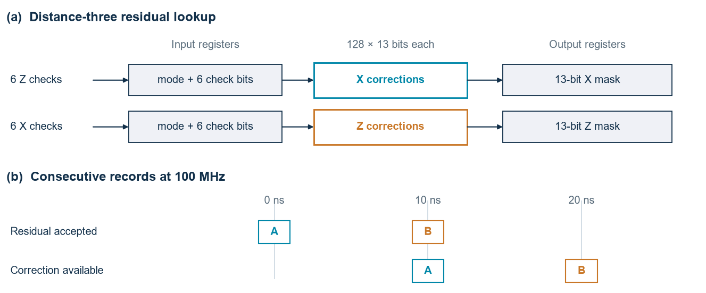

# Whole-patch cleanup at distance three

The input is a complete residual syndrome from the unrotated distance-three surface code with perfect checks. Six Z-check outcomes select an X correction and six X-check outcomes select a Z correction. Each mask has one bit per data qubit, in the same row order as the [spatial decoder](../qec/spatial.py). The surrounding system forms the residual before this block and combines the returned correction with the CNN's proposal afterwards.



For this small patch each component has only 64 possible syndromes. I ran the existing MWPM and HDRG software on all of them and stored their answers in [two ROM images](../rtl/cleanup_d3/). A seventh address bit selects the algorithm. The FPGA looks up the stored answers in parallel. The MWPM entries use PyMatching 2.4.0 and uniform edge weights for the spatial experiment at physical error probability 0.13. Where several paths have the same minimum weight, the table keeps the path returned by that software version.

The [RTL testbench](../examples/cleanup_d3/tb_cleanup.sv) exercises every combination of both syndromes and both modes, with consecutive inputs, idle clocks and a pending input discarded by reset. All 8,192 returned records matched the software masks. The [checker](../scripts/check_cleanup_d3.py) also checks the syndrome of every correction and independently enumerates all 8,192 possible physical masks per component to verify the minimum weights. Errors with the same syndrome can differ by a logical operator. These checks establish faithful execution of the selected decoder.

The core accepts an input at one rising edge and returns a valid correction at the next. Vivado 2026.1 routed the isolated design for the Arty's XC7A100T-CSG324-1 at 100 MHz, using 41 LUTs and 41 flip-flops. Worst setup and hold slack were +7.648 ns and +0.172 ns. This gives a 10 ns registered lookup and one new record per clock. The result combines RTL simulation with internal routed timing. The QPU link, residual construction and final Pauli-frame update have separate costs.

Table storage is the limit. At distance five there are 20 check bits per component and 41 correction bits. The same two-component, two-mode arrangement would need 171,966,464 uncompressed table bits. This small implementation therefore supplies a latency bound only for its specified distance-three inputs.

## Reproduce the check

From the repository root, with Vivado's simulator on the path, run

```sh
python -m pip install -r requirements-core.txt
python scripts/check_cleanup_d3.py --simulate
```

Use `--tool-dir` to select a simulator bin directory, or `--simulator iverilog` for Icarus. The runner creates a fresh directory under `build/`, records every returned mask and compares it with the software calculation. To regenerate the two ROMs in a separate directory, run

```sh
python scripts/check_cleanup_d3.py --write build/cleanup-roms
```

For the internal timing check, start in a new scratch directory and run `vivado -mode batch -source <repository>/scripts/build_cleanup_d3.tcl`. The script writes local timing, routing and utilisation reports.
