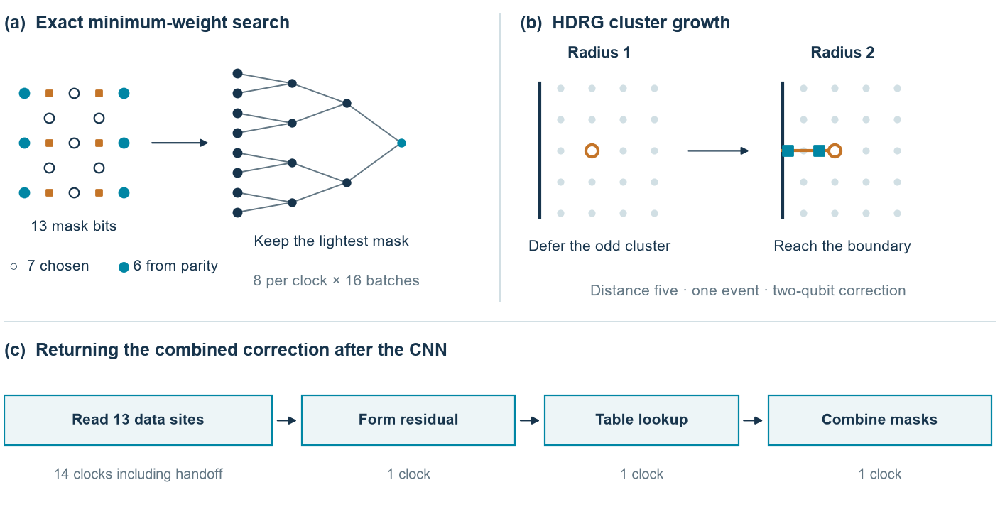

# Global cleanup on an FPGA

A CNN proposes corrections using a local neighbourhood. To finish the patch, we have to account for those proposals and correct any checks that are still fired. These examples use an unrotated 2D patch with perfect check measurements. The inputs are separate X- and Z-check components, and the outputs are two correction masks in data-qubit raster order.

## How long does cleanup take?

| Standalone core | Distance | Clocks from accepted residual to both masks | Time at 100 MHz | LUTs | Flip-flops |
|---|---:|---:|---:|---:|---:|
| [MWPM or HDRG lookup](../rtl/cleanup_d3/cleanup_d3.v) | 3 | 1 | 10 ns | 41 | 41 |
| [Exact minimum-weight search](../rtl/minimum_weight_d3/minimum_weight_d3.v) | 3 | 21 | 210 ns | 282 | 418 |
| [HDRG cluster growth](../rtl/hdrg_online/hdrg_online.sv) | 3 | 1–9 | 10–90 ns | 153 | 85 |
| HDRG cluster growth | 5 | 1–27 | 10–270 ns | 673 | 255 |

The cycle counts come from executing the RTL. Each of these four builds passed internal setup and hold timing at 100 MHz on the Arty A7-100T target in Vivado 2026.1. All four used zero DSPs and zero block RAM. The figures describe an isolated core with an input ready to accept. Queueing, host or QPU transport and controller action take additional time. The [timing and resource data](../results/global_cleanup_rtl.csv) also give the start and finish events for the connected experiment below.

### Looking up a correction

The distance-three patch has six checks per component. Each component therefore has just 64 possible inputs. The [two ROMs](../rtl/cleanup_d3/) store the MWPM and HDRG answer to each one. A mode bit selects the algorithm. The check against PyMatching 2.4.0 uses uniform edge costs from the spatial experiment at physical error probability 0.13. The core can accept a new record on every clock.


Every one of the 8,192 input/mode combinations reproduced the software mask. The checker enumerates all 8,192 physical masks in each component to verify the minimum weights. At distance five the same two-mode arrangement would need 171,966,464 uncompressed bits, so the other two examples calculate the answer after the syndrome arrives.

### Calculating a correction

The exact search chooses seven of the thirteen mask bits. The six parity checks determine the remaining bits. It evaluates eight of the resulting 128 masks each clock, keeping the lightest. Both components run in parallel. The first result takes 21 clocks and a new pair of syndromes can start every 16 clocks. This solves the uniform minimum-weight objective by enumeration. PyMatching implements blossom and can select another path in a tie. All 4,096 joint inputs gave a minimum-weight correction. The returned path differed from PyMatching on 9 of 64 X inputs and 13 of 64 Z inputs. Either choice clears the checks, but tied paths can differ by a logical operator.

The HDRG engine seeds a cluster from a fired check, grows it to its neighbours and chooses paths to neutralise it. An odd cluster that cannot yet reach a boundary waits for the next radius. Its completion time depends on the input. The two components run independently and the output becomes valid when both finish. A new record can start at the following rising edge.

All 4,096 distance-three input pairs matched the Python HDRG decoder exactly. At distance five, xsim checked 1,235 joint inputs against that decoder. A separate Verilator run exercised all 1,048,576 inputs of each component. An independent breadth-first reference checked every returned mask and its cycle count. Eight inputs in each orientation took 27 clocks. Presenting a slowest input on both sides together reproduced that time. Independence makes 27 clocks the maximum over all pairs at this distance.



## Connecting cleanup to the CNN

The [hybrid top](../rtl/hybrid_d3/cnn_cleanup_d3.v) runs the existing integer CNN. When its last prediction reaches decision RAM, the wrapper reads the 13 data sites, calculates the residual, looks up both global masks and combines them with the local predictions. The readback and handoff take 14 clocks. Residual formation, lookup and the final XOR each take one more clock.

The [connected test](../scripts/check_hybrid_d3.py) checked 32 distinct syndromes in both modes. Every local and combined mask matched the integer software reference. From a preloaded input frame, the CNN took 1,671 clocks and the combined result was ready at 1,688 clocks. The whole design passed internal timing at 100 MHz on the Arty target (+0.069 ns setup and +0.082 ns hold slack), using 41,474 LUTs, 22,553 flip-flops, 5.5 block RAM tiles and 189 DSPs. The 17-clock increment is 170 ns at that clock, and the full frame takes 16.88 µs. Loading the input and delivering the output to a controller take additional time. This wrapper uses the lookup method.

## Reproduce the experiments

Install the software dependencies with `python -m pip install -r requirements-core.txt`. With Vivado's simulator on the path, run the following from the repository root.

```sh
python scripts/check_cleanup_d3.py --simulate
python scripts/check_minimum_weight_d3.py --simulate
python scripts/check_hdrg_online.py --distance 3
python scripts/check_hdrg_online.py --distance 5
python scripts/check_hybrid_d3.py
```

Each command accepts `--tool-dir` for a simulator bin directory and `--simulator iverilog` for Icarus Verilog. The [lookup checker](../scripts/check_cleanup_d3.py) can also regenerate the ROMs with `--write build/cleanup-roms`. The [search checker](../scripts/check_minimum_weight_d3.py) verifies minimum weight independently. The [HDRG checker](../scripts/check_hdrg_online.py) compares against the spatial software decoder.

To repeat the exhaustive distance-five HDL run, use Verilator, CMake and a C++20 compiler. The [test harness](../examples/hdrg_online/exhaustive.cpp) includes a simultaneous worst-case check.

```sh
cmake -S examples/hdrg_online -B build/hdrg-d5 -DCMAKE_BUILD_TYPE=Release
cmake --build build/hdrg-d5 --config Release
ctest --test-dir build/hdrg-d5 -C Release --output-on-failure
```

Set `VERILATOR_ROOT` if CMake needs the path to your installation.

The Vivado build scripts cover the [lookup](../scripts/build_cleanup_d3.tcl), [minimum-weight search](../scripts/build_minimum_weight_d3.tcl), [HDRG](../scripts/build_hdrg_online.tcl) and [connected hybrid](../scripts/build_hybrid_d3.tcl). Run each in its own scratch directory, for example `vivado -mode batch -source <repository>/scripts/build_hdrg_online.tcl -tclargs 5`. Each writes routing, timing and utilisation reports.
