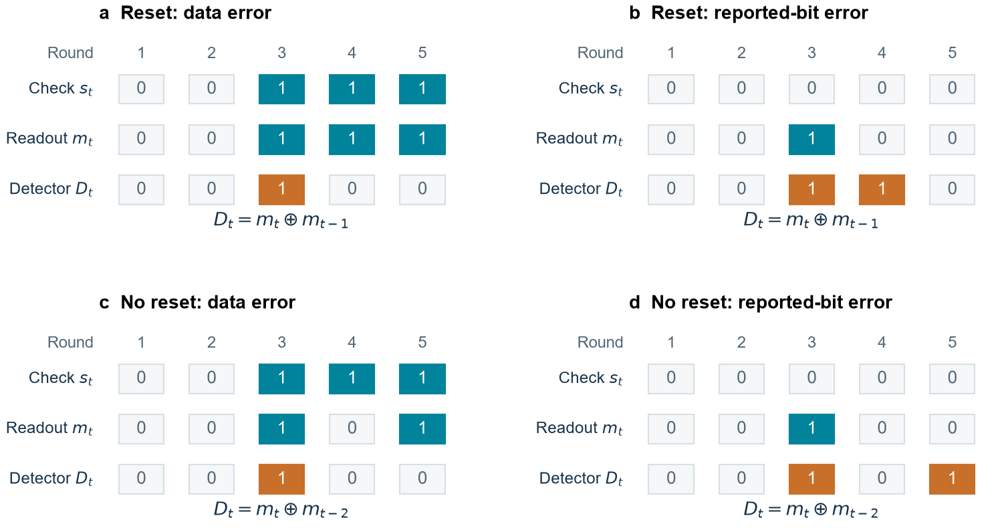

# Quantum experiments and software decoders

The Python package contains the input encoding, neural inference, HDRG, matching and IBM circuits used to study decoder quality. The networks use the trained parameters described in [the attribution](../ATTRIBUTION.md). The experiments on this page measure whether the correction protects the encoded information. The [FPGA cleanup study](distance-three-cleanup.md) measures the time a small circuit takes to produce a correction from a residual syndrome.

Run commands from the repository root. Install the analysis dependencies in a virtual environment:

```sh
python -m pip install -r requirements-analysis.txt
python -m unittest discover -s tests -p test_qec.py -v
```

The requirements record the versions tested for this package. For 2D comparisons alone, use `requirements-core.txt`. `requirements-cnn.txt` adds PyTorch for 3D neural inference, and `requirements-ibm.txt` adds Qiskit for circuit construction and submission. The full analysis file installs both. CPU execution is the default. A CUDA-compatible PyTorch installation is optional for larger simulations. No IBM account is opened when importing the numerical modules or running the tests.

## Decoder comparisons

```sh
python -m qec.simulate_2d --distances 3 5 --probabilities 0.05 0.1 --shots 128 --precision float integer --output build/spatial
python -m qec.simulate_3d --distances 3 --basis X Z --probabilities 0.005 --shots 64 --precision float integer --output build/memory
```

These are small runnable examples, not the sample sizes behind the thesis plots. Both commands accept larger distance lists, `--shots`, `--passes`, `--seed`, `--batch` and `--device cuda`. For example, `--distances 9 17 25 33` selects four larger patches. The space-time circuit uses as many measurement rounds as the code distance unless `--rounds` is supplied. Memory use grows with the volume and batch size, so begin with a small batch.

| Experiment | Inputs and outcome |
|---|---|
| Spatial simulation | Independent depolarising data errors on an unrotated patch, with perfect checks. A complete failure means unresolved checks or a nontrivial logical error after correction. Both Pauli components are known. |
| Space-time simulation | A rotated patch with noisy gates, idle periods, ancilla resets and measurements. Failure means a wrong final logical parity for the prepared X or Z memory. Those are separate experiments. |
| IBM final-readout diagnostic | Product states or Bell pairs are prepared, delayed and measured. Measured errors are mapped to a decoder patch offline. There are no repeated stabiliser checks in this experiment. |
| IBM repeated memory | A rotated patch is checked repeatedly without ancilla resets, then its data qubits are measured. The saved measurement order determines the detector volume and measured logical parity. |

Every decoder sees the same shots within a condition. Comparisons include CNN alone, MWPM, HDRG and CNN followed by each global decoder. The simulated study also includes matching that uses circuit weights and Pauli correlations. Matching variants remain distinct because they use different information. Logical-parity failure and unresolved checks are saved separately. The strict-failure fields combine a wrong measured parity with any unresolved syndrome, so a CNN output is not counted as a complete correction just because its logical parity happens to match.

`simulate_3d --noise remove_four_data_idles` removes four specified data-idle noise channels per round while keeping the gates, reset, readout and CX-slot idle channels. This is a controlled noise comparison, not a second hardware design. Neither synthetic circuit is claimed to reproduce IBM noise exactly or to reproduce the original training sampler bit for bit.

Outputs contain the settings, software versions, source/model hashes, shot outcomes, counts and uncertainty intervals. The commands refuse to combine incompatible settings in one output folder. The execution time reported by Python is host computation time, not FPGA latency.

The [saved result tables](../results/README.md#decoder-comparisons) include the thesis's main one-pass comparisons and complete-decoding pruning experiment. For paired-score intervals from aggregate counts:

```sh
python -m qec.paired_score --worse-only 2347 --better-only 2581 --shots 65536
```

This example gives the distance-33 float CNN plus MWPM comparison: about −0.357 percentage points, with a 95% interval of −0.567 to −0.147 points. Negative values favour the hybrid. The helper reports Tango's pointwise asymptotic score interval; the original simulation output fields retain their conservative construction. The results guide explains the distinct 2D and 3D failure definitions.

## IBM circuit construction

Circuit generation is offline by default:

```sh
python -m qec.ibm_experiments idle --distance 5 --basis Z --prep ones --delay-us 10 --output build/idle-preview
python -m qec.ibm_experiments memory --distance 3 --rounds 3 --basis X --prep plus --output build/memory-preview
```

The preview uses a nominal rectangular backend to check circuit construction. It is labelled as a preview and contains no physical measurements. The actual study used `ibm_miami`. Its circuit-placement routine requires a rectangular coupling graph and checks that a repeated-memory patch fits without SWAP gates. Other device topologies need a different placement method.

The final-readout experiment supports X/Z product preparations, random product preparations, Bell pairs and optional XY4 pulses (`--xy4`). Bell pairs use `--basis BELL --prep bell` and require a distinct adjacent partner for every data qubit. Delay values are adjusted to backend timing constraints and the resulting duration is recorded.

The larger final-readout diagnostic uses `--placement calibration`. It selects data qubits by their calibration quality, including distance-five to eight cases when the device has enough qubits. These data are assigned to the decoder's logical raster order. They do **not** demonstrate an entangled surface-code memory of that distance on the chip. The geometric placement and calibration-selected diagnostic are kept identifiable in the records.

To submit a circuit, set `QISKIT_IBM_TOKEN` in the local environment and, if required, `QISKIT_IBM_INSTANCE`. Follow IBM's [account initialization guide](https://quantum.cloud.ibm.com/docs/en/guides/initialize-account). Do not put credentials in code or commands that you intend to share. Add `--submit` to a circuit command and choose an empty output folder. This is the only command that submits a new QPU job. It uses Qiskit Runtime's `SamplerV2` and disables automatic dynamical decoupling because the experiment controls its own pulses.

Retrieve its measurements with the same experiment type and output folder:

```sh
python -m qec.ibm_experiments memory --retrieve --output local-data/memory
```

The local `experiment.json` stores the job identifier for retrieval. It, measurement archives and circuit QPY files are ignored by Git. Credentials are never saved by these commands. Review any result file before sharing it.

## Offline IBM decoding

```sh
python -m qec.decode_ibm --input local-data/memory --passes 4 --precision integer --output build/ibm-decoding
```

An input folder contains `experiment.json` and `measurements.npz`. Product-state records use array `m`, Bell records use `mc` and `mt`, and repeated-memory records use `raw`. Columns follow increasing classical-bit index, not the order printed in Qiskit bitstrings. The manifest records the preparation bits, distance, basis and measurement rounds. The repeated-memory matching model uses the saved calibration medians rather than querying a later backend calibration.

The original notebook exports can be converted without running the notebooks or opening an IBM account:

```sh
python -m qec.import_ibm idle --input local-data/idle-exports --output local-data/idle
python -m qec.import_ibm memory --input local-data/memory-exports --output local-data/memory
```

The idle importer reads `raw_bits_2d.npz` and `tab10_1_configs.csv`. It includes the distance-five to eight final-readout diagnostic. The memory importer reads `raw_bits_3d.npz` and `submit_manifest_3d.json`. Each creates numbered condition folders for `decode_ibm`. Only required settings and arrays are copied. The measurement archives themselves are not included in this source repository.

For no-reset memory, consecutive raw ancilla measurements must first be XORed to recover check values. Differences between those check values form the detectors. The circuit mirror models ancilla readout noise as a state flip before measurement. A purely classical readout misreport would propagate differently and is not the same noise model. The tests compare the conversion with Stim's measurement-to-detector conversion for both bases and several preparations.



*Each example starts with one known-zero check and a zero ancilla. A persistent data error changes the check once. An isolated classical recording error produces two detection events: one round apart with reset, or two apart without reset. This recording error is distinct from a physical state flip before measurement. The circuit determines which boundary checks are known.*

## Additional experiments

```sh
python -m qec.pruning --shots 200 --output build/pruning
python -m qec.decay --inputs local-data/idle/idle_000 local-data/idle/idle_001 local-data/idle/idle_002 local-data/idle/idle_003 --output build/decay.json
```

Pruning sets small floating-point weights to zero and evaluates one CNN pass on the studied distance-33 pair of 3×3 Z-cut defects. It reports sparsity, agreement with the unpruned network and remaining error pixels. Biases are unchanged. It does not measure a sparse FPGA implementation or logical failure after global cleanup. The command uses a fixed seed and a float64 reference. The initial notebook used unseeded random inputs and Keras float32, so the procedure can be repeated but its individual random trials cannot be reproduced exactly.

Decay fitting groups final-readout conditions by backend, selected qubits, distance, basis, preparation and XY4, with at least four distinct delays per curve. Supply matching condition folders, or all folders in the export through your shell. The fit returns an effective decay time and its fitted standard error, not an independent T1/T2 calibration. A fitted lifetime outside the observed delay range is flagged as extrapolation.

The array-only model exports contain numerical parameters and can be loaded with `allow_pickle=False`. Their coefficient values are unchanged. The integer tests compare both networks against the same intermediate activation and output fixtures used by the HDL examples.
