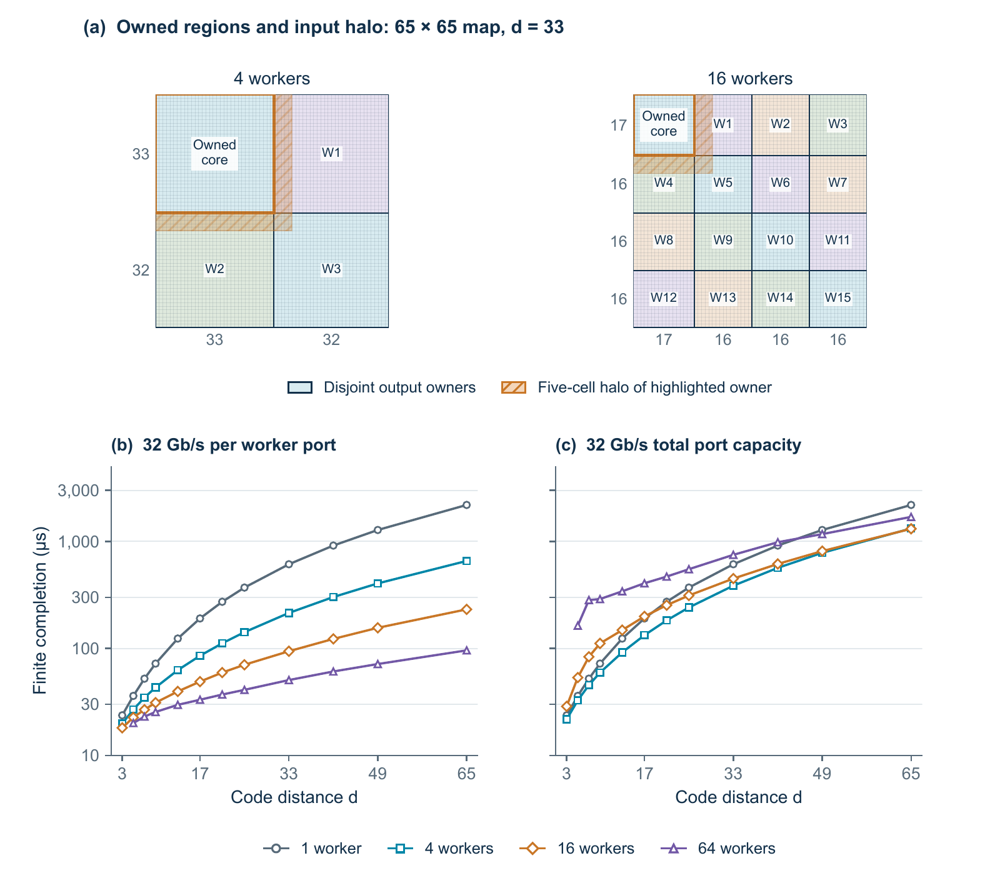

# Results

The tables below summarise selected thesis experiments. They separate three different measurements: a core running on an Arty board, a simulated network of workers, and internal timing analysis for a routed component on a larger FPGA. Their start and end points differ, so the times should not be ranked as if they measured the same complete decoder. The [CSV guide](../results/README.md) explains the columns and scope of the accompanying data.

## Physical Arty measurements

The board experiments used an Arty A7-100T. Inputs were loaded over USB/UART, the FPGA returned its decisions and a cycle count, and the host compared the decisions with the integer reference. Each of the nine configurations below completed 1,000 transactions drawn from 67 distinct fixtures. Repeating a fixture checks repeated operation; it does not create a new independent quantum-error sample.

| Core | Distance | Parallel configuration | Clock | Core cycles | Core time |
|---|---:|---|---:|---:|---:|
| 2D | 5 | 11/4/6 tap lanes | 100 MHz | 4,377 | 43.770 µs |
| 2D | 9 | 11/4/6 tap lanes | 100 MHz | 12,561 | 125.610 µs |
| 2D | 17 | 11/4/6 tap lanes | 100 MHz | 41,601 | 416.010 µs |
| 2D | 25 | 11/4/6 tap lanes | 100 MHz | 87,537 | 875.370 µs |
| 2D | 33 | 11/4/6 tap lanes | 100 MHz | 150,369 | 1,503.690 µs |
| 2D | 5 | 11/6/6 tap lanes | 90 MHz | 3,486 | 38.733 µs |
| 2D | 33 | 11/6/6 tap lanes | 90 MHz | 103,894 | 1,154.378 µs |
| 3D | 5 | T16, five rounds | 100 MHz | 427,475 | 4,274.750 µs |
| 3D | 5 | T32, five rounds | 95 MHz | 223,603 | 2,353.716 µs |

The 2D configuration lists tap lanes in the three layers. In 3D, T16 and T32 denote the number of hidden output channels calculated in parallel. These are different forms of parallelism. The counters exclude input loading, external output transfer and global decoding. The clocks are configured nominal frequencies, not independent oscillator measurements. Each listed configuration passed its internal implementation timing check; the T32 build's setup margin was only +0.003 ns.

[Board result CSV](../results/board_results.csv)

The thesis also reports an earlier shared-schedule 2D baseline of 22,632 board cycles. The retained source simulates in 22,630 cycles. The saved artifacts do not establish the cause of that two-cycle difference, so it remains identified separately rather than treated as an exact agreement.

## Distributed 2D simulation

The study covered 47 nonempty combinations of code distance and worker count. It used distances 3, 5, 7, 9, 13, 17, 21, 25, 33, 41, 49 and 65, with one, four, sixteen or sixty-four workers where the partition was nonempty. The functional checks compare every owned intermediate value and final decision with the undivided integer calculation.

Each output belongs to one worker. A worker also needs nearby values from neighbouring regions, called its halo. Increasing the worker count reduces local computation but increases overlapping data and communication.

At distance 33, the following completion times run from the first accepted host input to the final returned prediction. Worker and fabric clock periods are both 10 ns. Each direction has its own stated communication budget.

| Workers | 32 Gbit/s per worker port | 32 Gbit/s total | 128 Gbit/s total |
|---:|---:|---:|---:|
| 1 | 611.700 µs | 611.700 µs | — |
| 4 | 214.580 µs | 385.780 µs | 214.580 µs |
| 16 | 94.120 µs | 449.310 µs | 149.560 µs |
| 64 | 50.630 µs | 749.070 µs | 209.770 µs |

More workers consistently help in the per-port study because total communication capacity grows with worker count. Under the fixed 32 Gbit/s budget, four workers are fastest through distance 49; sixteen are only narrowly faster at distance 65. There is no universal best board count. A separate one-worker 128 Gbit/s case was not run because its port remains capped at 32 Gbit/s.

The links are digital simulation interfaces with a behavioural switch, not physical transceivers or cables. The results include the simulated loading, computation, exchange and return path, but exclude global decoding and a live quantum controller. Frames are separated by reset; these results do not establish continuous service. The [scaling CSV](../results/distributed_scaling.csv) contains the independent-port and fixed-32 Gbit/s curves. The [128 Gbit/s CSV](../results/distributed_128gbps.csv) records the extra comparison, including the reused four-worker point.

A separate twelve-frame test used a 62.5 MHz worker clock and 100 MHz fabric clock, corresponding to one internally timed VU13P endpoint. It completed in approximately 134 µs at distance 33 with sixteen workers. The [frame table](../results/distributed_clock_matched.csv) includes six normal frames and six completed frames after a reset during operation. Only that one endpoint geometry has the associated device timing evidence. The complete sixteen-worker system remained simulated.

A small [queue-depth pilot](../results/distributed_queue_depth.csv) checked one and four workers at distance nine. Eight-record queues reduced completion compared with four-record queues; sixteen records gave no further improvement in those cases. The main scaling curves retain their original four-record queues.

## Internal timing on larger devices

Vivado implementation was also attempted for selected complete components. Two resident-worker attempts on VU13P failed routing. Four other components achieved legal internal routing and passed internal timing at the checked clocks below. These are checked operating points, not maximum-frequency measurements.

| Component | Device | Checked internal clock | Setup margin | Hold margin |
|---|---|---:|---:|---:|
| 2D resident worker, distance 33, direct and simplified memory addressing | VU13P | Neither routed | — | — |
| One interior distributed worker, distance 33 | VU13P | 62.5 MHz worker / 100 MHz fabric | +2.682 / +5.024 ns | +0.010 / +0.045 ns |
| Finite 3D core, distance 5, T64 | VU13P | 100 MHz | +0.170 ns | +0.011 ns |
| Finite 3D core, distance 49, T64 | VP1802 | 83⅓ MHz | +0.907 ns | +0.012 ns |
| 2D resident worker, distance 33, three spatial lanes | VP1902 | 100 MHz | +1.415 ns | +0.010 ns |

The original clock targets failed setup where routing succeeded. The slower clocks were checked on the unchanged routed circuits. For example, the VP1902 resident worker failed its initial 250 MHz target by 4.587 ns before passing internal timing at 100 MHz.

For that VP1902 core, three unpaused simulations each took 2,180 cycles from accepted start to the final result write. At the internally qualified 100 MHz clock, this corresponds to **21.8 µs**. Inputs were already loaded, and external readback and global decoding are excluded. Deliberately paused fixtures took longer. This is not the same endpoint as the distributed packet-based result above, and it is not a measurement on a physical VP1902 board.

The [resident-cycle table](../results/resident_cycles.csv) also preserves the layer-overlap comparison and larger maps through distance 97. For example, at distance 33 with sixteen spatial lanes, overlapping the layers reduces 1,174 cycles to 478 at the same assumed clock. These cycle comparisons do not establish a routed clock for every configuration.

The distance-49 3D core stores complete finite volumes in UltraRAM. Its 30,438,881 verified cycles at an exact 12 ns period correspond to about **365.27 ms** for the preloaded calculation. Demonstrating storage capacity does not establish a useful continuous quantum-round processing rate.

[Internal timing CSV](../results/native_timing.csv)

## What these results do not claim

Correct integer arithmetic does not by itself establish successful quantum error correction. Decoder quality is evaluated separately in the thesis using shared simulated faults and quantum-device records. Likewise, a fast neural core does not include the time to construct the residual, run the global decoder and deliver a correction to a controller.

The remaining system work includes physical high-end board tests, real inter-board links, sustained input handling and an accessible quantum-controller feedback interface. The repository's small examples check that the packaged sources remain usable; they do not repeat the complete thesis evaluation.
