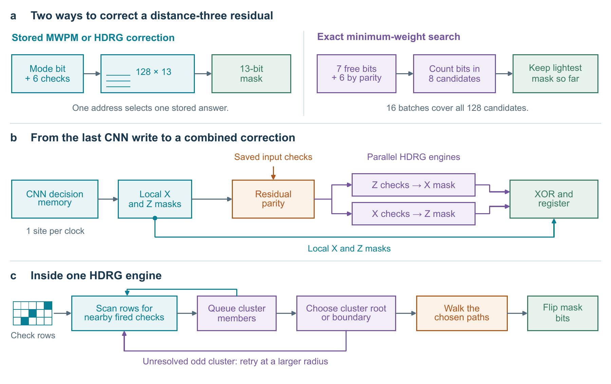

# Global cleanup after the CNN

The spatial CNN proposes a correction for each data qubit. Some checks can still be fired after those proposals are applied. This experiment asks how long the FPGA needs to read the CNN output, resolve the remaining checks and return a complete correction. The inputs are 2D surface-code patches with perfect check measurements.

[](assets/global-cleanup.pdf)

**Figure B.3, Appendix B.8.** Panel (a) shows two small-patch designs. The lookup reads an answer computed in advance by minimum-weight perfect matching (MWPM) or hard-decision renormalisation group (HDRG), a clustering decoder. The exact search tries the correction masks consistent with the checks and selects one of minimum weight. Panels (b) and (c) show the HDRG implementation tested through distance 33. [Vector PDF](assets/global-cleanup.pdf) · [Small-patch implementations and timing](distance-three-cleanup.md)

## What the timer measures

The [connected circuit](../rtl/hybrid_hdrg/cnn_hdrg.sv) saves the original checks when it loads a frame. After the CNN writes its last prediction, the circuit reads one data qubit’s X and Z decisions per clock. For each check, it compares the parity of the neighbouring predictions with the saved check bit. The checks still left to explain form the *residual*.

Two [HDRG engines](../rtl/hdrg_stream/hdrg_stream.sv) then work in parallel. One uses the residual Z checks to find an X correction. The other uses the residual X checks to find a Z correction. Each engine queues nearby fired checks into a cluster and follows paths to resolve it. When both masks are ready, the circuit XORs them with the CNN masks. The final register stops the timer.

At distance 33 the handoff, 2,113 data-site reads and acceptance of the residual take **2,115 clocks**. Even an empty patch takes 33 search clocks. One more clock combines the masks, giving 2,149 clocks after the CNN. With every input check fired, the same circuit takes 24,528 extra clocks. Both measurements start with the input already on the FPGA. Loading it from a controller and delivering the final correction would take additional time.

## Distance-33 results

For each frame I ran HDRG on the original checks, then on the residual left by the integer CNN. Each data qubit had a 13% chance of an X, Y or Z error, with the three errors equally likely. Each row below uses 32 frames. The independent test uses a different seed.

| Frames | HDRG on original checks, median clocks | HDRG on residual, median clocks | Added time after the CNN, median | Added time, observed range |
|---|---:|---:|---:|---:|
| [Chapter 8 sample](../results/cnn_hdrg_frames.csv), seed 20261109 | 4,746 | 1,163 | 32.79 µs | 30.28–45.60 µs |
| [Appendix B.8 check](../results/independent_cleanup_d33_frames.csv), seed 405731 | 4,658 | 1,284.5 | 34.005 µs | 28.27–41.94 µs |

The original-check and residual columns time the HDRG search. The last two columns also count readback and the final register. Times use the 100 MHz clock met by the routed distance-33 design. The median of 32 integer counts can fall halfway between two clocks.

On every frame in both samples the search finished sooner after the CNN. The CNN itself took 150,369 clocks per frame, so direct HDRG still returned a complete correction sooner on every input. The independent run also checked the residual search in a second simulator. Vivado XSim reproduced the search time on each of the 32 residuals, and both simulators agreed with the software correction masks. The [decoder-quality experiments](quantum-experiments.md) test how often the correction succeeds.

## Distance sweep and routed clock

The connected RTL ran at distances 3, 5, 7, 9, 13, 17, 21, 25, 29 and 33. At each distance I checked four fixed patterns and four random frames at each of 1%, 5%, 13% and 20% physical error probability. The standalone tests covered all 4,096 joint syndromes at distance three and 95 cases at each larger distance. [Connected frame counts](../results/cnn_hdrg_frames.csv) · [Standalone search counts](../results/hdrg_stream_distances.csv)

The complete distance-33 circuit met a 10 ns clock period after routing on a Virtex UltraScale+ VU13P (xcvu13p-flga2577-3-e). Setup slack was +1.858 ns, hold slack +0.040 ns and pulse-width slack +4.505 ns. The implementation used 59,383 LUTs, 38,048 flip-flops, 77.5 BRAM36 tiles and 189 DSPs. The latency figures above combine simulated cycles with this internal timing result. [Connected route](../results/cnn_hdrg_route.csv) · [Standalone routes](../results/hdrg_stream_routes.csv)

## Can the added time be bounded?

For this circuit and one preloaded distance-33 frame, a conservative upper bound is **172,301 extra clocks**. It includes 2,115 clocks before the cluster engines accept the residual, at most 170,185 search clocks and one output clock. The exact worst-case input at distance 33 is unknown.

To see where the bound comes from, consider one engine. A component has at most 33 check rows and 1,056 fired checks. When the radius reaches 16, every check can reach an absorbing boundary. There are at most five passes with radii 1, 2, 4, 8 and 16. At each pass the seed scan spends at most 33 clocks advancing rows. If that pass has n fired checks in c clusters, queue and cluster control use another 3n + 3c clocks. There are at most as many clusters as checks. A check's search window covers at most 3, 5, 9, 17 and 33 rows in the successive passes, a total of 67. Finally, each check is resolved only once. A longest path within the grid spans at most 63 edges, plus one retirement clock. Four transitions suffice between passes. Adding these allowances gives 5 × 33 + 1,056 × (30 + 67 + 64) + 4 = 170,185. The two engines run at the same time, so the slower one determines the result.

## Repeat the tests

Install the Python dependencies from the repository root. For a small example, put Icarus Verilog on the path and run:

```sh
python -m pip install -r requirements-core.txt
python scripts/check_hdrg_stream.py --distance 7 --samples 1 --simulator iverilog
python scripts/check_hybrid_hdrg.py --distance 3 --samples-per-rate 1 --simulator iverilog
```

To reproduce the independent distance-33 result, use Verilator, CMake 3.20 or newer and a C++20 compiler for the connected circuit. Use Vivado XSim for the two standalone runs. The connected run uses the integer CNN and checks its local decisions, residual and combined correction against software.

```sh
python scripts/check_hybrid_hdrg.py --distance 33 --simulator verilator --noise-rate 0.13 --samples-per-rate 32 --seed 405731
```

In the commands below, replace `CONNECTED_RUN` with the directory printed by that command. The two hex files list the original and residual checks in the same frame order. Each standalone run prints its own directory. Pass those as `RAW_RUN` and `RESIDUAL_RUN` to compare the results with the published CSV.

```sh
python scripts/check_hdrg_stream.py --distance 33 --simulator xsim --input-hex "CONNECTED_RUN/raw_syndromes.hex"
python scripts/check_hdrg_stream.py --distance 33 --simulator xsim --input-hex "CONNECTED_RUN/residual_syndromes.hex"
python scripts/check_cleanup_frames.py "CONNECTED_RUN" "RAW_RUN" "RESIDUAL_RUN"
```

For the Chapter 8 sample, use seed `20261109` in the connected command. Compare that run with the rows labelled `paired_p013` in the original frame table. The comparison script above checks the independent sample with seed 405731. Running the two simulator launchers at a distance without `--noise-rate` or `--input-hex` uses their standard mix of test inputs.

The [connected Vivado build](../scripts/build_hybrid_hdrg.tcl) takes the distance, part and clock period in nanoseconds. For the routed result, launch Vivado in an empty scratch directory and pass `-tclargs 33 xcvu13p-flga2577-3-e 10.0`. The [standalone build](../scripts/build_hdrg_stream.tcl) and [clock recheck](../scripts/check_hdrg_stream_timing.tcl) cover the two cluster engines alone.
