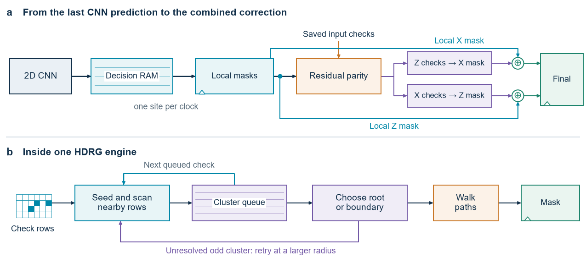

# Cleanup on larger patches

How much time passes between the last local CNN prediction and a complete correction? This design connects the banked integer 2D CNN to two HDRG cluster engines. Each frame describes an unrotated surface-code patch with perfect check measurements. One engine finds an X mask from the residual Z checks. The other finds a Z mask from the residual X checks.



## Readback and search

The [connected top](../rtl/hybrid_hdrg/cnn_hdrg.sv) saves the original checks while loading the frame. Once the CNN finishes, it reads one data qubit's X and Z predictions per clock from decision RAM. Each original check is XORed with the parity predicted by its neighbouring data sites. The two [HDRG engines](../rtl/hdrg_stream/hdrg_stream.sv) start together on those residuals. Each holds the remaining checks in rows and records the members of a cluster in a queue. When it can resolve that cluster, it walks the selected paths and flips one correction bit per step. A final register combines the local and global masks component by component.

At distance 33, the CNN writes its last prediction at clock 150,369. The handoff, 2,113 data-site reads and acceptance of the residual take another 2,115 clocks. The rest depends on the input. The empty patch takes 33 HDRG clocks and one final XOR clock, giving **2,149 extra clocks**. With every input check fired, it takes 22,412 HDRG clocks and one final XOR clock, giving **24,528 extra clocks**. Input loading and delivery to a quantum controller are outside these intervals.

A second test used 32 fresh distance-33 frames with a 13% physical data-error probability. Running the same HDRG logic directly on the original checks took a median of 4,746 clocks. On the CNN residual, the median was 1,163. Including readback and the final register gave 3,279 extra clocks after inference (range 3,028–4,560). Adding the fixed CNN time gave a median of 153,648 clocks from a loaded frame. Search was faster on every residual, but adding the CNN increased total clocks on all 32 frames. This comparison measures latency; the decoder-quality study uses its own trials.

## What was verified

* The [standalone tests](../scripts/check_hdrg_stream.py) compared both RTL correction masks with the [spatial HDRG reference](../qec/hdrg.py). They covered all 4,096 joint syndromes at distance three and 95 selected cases at each of nine larger distances. Each larger set included physical Pauli errors, independently fired checks and directed patterns.
* The [connected tests](../scripts/check_hybrid_hdrg.py) checked the integer CNN decisions, the residual, both global masks and the combined result. The initial sweep covered distances 3, 5, 7, 9, 13, 17, 21, 25, 29 and 33. Each distance had four directed patterns and four independent trials at each physical error probability of 1%, 5%, 13% and 20%. An additional paired run at distance 33 compares cleanup of exactly the same frames before and after the CNN.
* The [frame results](../results/cnn_hdrg_frames.csv) report elapsed RTL clocks. The [standalone summary](../results/hdrg_stream_distances.csv) and [route results](../results/hdrg_stream_routes.csv) cover the residual-only circuit. A sampled maximum at a larger distance is the longest observed case. Only the separate [small-patch designs](distance-three-cleanup.md) have the exhaustive distance-five HDRG bound or a distance-three exact minimum-weight implementation.

## Can the added time be bounded?

For this circuit and one preloaded distance-33 frame, a conservative upper bound is **172,301 extra clocks**. It includes 2,115 clocks before the cluster engines accept the residual, at most 170,185 search clocks and one output clock. The exact worst-case input at distance 33 is unknown.

To see where the bound comes from, consider one engine. A component has at most 33 check rows and 1,056 fired checks. When the radius reaches 16, every check can reach an absorbing boundary. There are at most five passes with radii 1, 2, 4, 8 and 16. At each pass the seed scan spends at most 33 clocks advancing rows. If that pass has n fired checks in c clusters, queue and cluster control use another 3n + 3c clocks. There are at most as many clusters as checks. A check's search window covers at most 3, 5, 9, 17 and 33 rows in the successive passes, a total of 67. Finally, each check is resolved only once. A longest path within the grid spans at most 63 edges, plus one retirement clock. Four transitions suffice between passes. Adding these allowances gives 5 × 33 + 1,056 × (30 + 67 + 64) + 4 = 170,185. The two engines run at the same time, so the slower one determines the result.

## Repeat the tests

Install the dependencies in [requirements-core.txt](../requirements-core.txt). For quick simulator checks, place Icarus Verilog on the path and run from the repository root.

```sh
python scripts/check_hdrg_stream.py --distance 7 --samples 1 --simulator iverilog
python scripts/check_hybrid_hdrg.py --distance 3 --samples-per-rate 1 --simulator iverilog
```

For the full size, the standalone test uses Vivado XSim by default. The connected test uses Verilator, CMake and a C++20 compiler. The commands write their inputs and results to separate directories under `build/`.

```sh
python scripts/check_hdrg_stream.py --distance 33
python scripts/check_hybrid_hdrg.py --distance 33
python scripts/check_hybrid_hdrg.py --distance 33 --noise-rate 0.13 --samples-per-rate 32 --seed 20261109
```

The connected run saves the original check bits in `raw_syndromes.hex`. To repeat the paired comparison, run `python scripts/check_hdrg_stream.py --distance 33 --input-hex <connected-run>/raw_syndromes.hex`, replacing `<connected-run>` with the run directory printed by the connected test.

For implementation, launch Vivado in an empty scratch directory. The [connected build](../scripts/build_hybrid_hdrg.tcl) takes distance, part and clock period in nanoseconds. For example, pass `-tclargs 33 xcvu13p-flga2577-3-e 10.0`. The [standalone build](../scripts/build_hdrg_stream.tcl) and [clock recheck](../scripts/check_hdrg_stream_timing.tcl) cover the two cluster engines alone.
