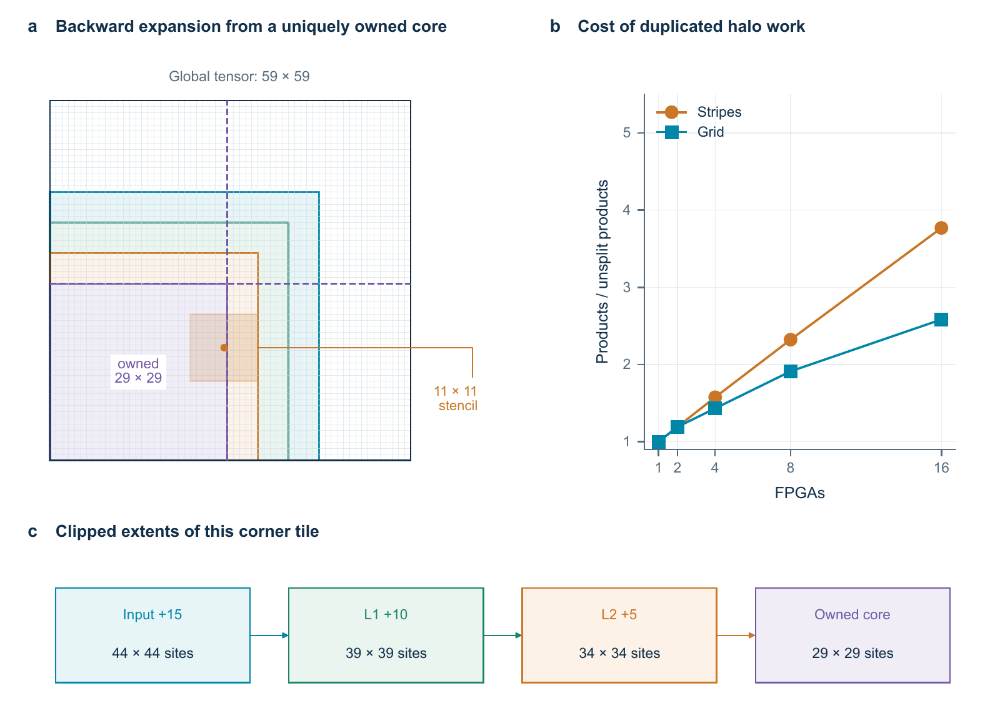

# Larger spatial decoders

The two designs here explore different ways to run the same three-layer integer
CNN. The resident design keeps the feature maps in one device and overlaps the
layers. The distributed design divides each map between workers and exchanges
the neighbouring values needed for each convolution.

These are separate implementations. Their modules deliberately keep the names
used in the experiments, so compile one design's source directory at a time.
The launcher below supplies the correct source list.

## Resident worker

`rtl/resident_2d/worker_rowready.sv` is the top-level module. Its parameters are:

| Parameter | Meaning |
| --- | --- |
| `N` | Side length of the feature map; `N = 2d - 1` for code distance `d` |
| `V` | Number of spatial positions processed in parallel |
| `CW`, `BW` | Coordinate and memory-bank address widths, derived from `N` and `V` |

Load a complete input while `load_ready` is high, then pulse `start`. The selected
`frame_slot` stays fixed for that calculation. Each downstream layer starts
reading as soon as its required source sites have been written on earlier clock
edges. This overlaps the layers without reading incomplete results.

`issue_enable` pauses new reads, rather than freezing the whole pipeline. Data
already in flight still reaches the next layer. The result interface has no
backpressure: every valid output must be accepted. After completion, the two
result slots can be read through the synchronous readback port.

The resident feeder uses constant lane offsets to simplify address calculation.
The code preserves the tested arithmetic and control. It does not automatically
choose a device or guarantee that a particular `N` and `V` will fit.

## Distributed worker

`rtl/distributed_2d/tile_board.sv` is one worker. A square `GRID × GRID` partition
assigns contiguous map regions, giving the first partitions one extra row or
column when `N` is not divisible by `GRID`. `T` is the maximum owned side length,
`ceil(N / GRID)`, and `ID` identifies the worker.

Each 11 × 11 convolution needs a five-site border around the owned region. This
border is often called a *halo*. The worker waits for a complete layer input,
computes the allocated tile, and returns its owned outputs. Intermediate values
are forwarded to every worker that needs them for the next layer. Padding is
stored locally; it is not an additional owned part of the global map.



The diagram illustrates overlapping regions, not the small example's exact
geometry.

Two asynchronous FIFOs connect each worker to the simulated fabric. They carry
320-bit records with coordinates, layer, source, destination, frame, epoch and
CRC. Both sides of a FIFO share a coordinated reset. The design does not support
resetting one side independently while preserving queued records.

The example testbench supplies a behavioural multicast switch. It forwards
actual computed values, not values from the reference arrays. This is useful
for checking ownership, communication and arithmetic together, but it is not a
physical transceiver implementation.

## Small examples

Both examples use Python 3. The resident example uses Icarus Verilog, with
`iverilog` and `vvp` on PATH. The distributed example uses Verilator 5.052, CMake
3.20 or later and a C++20 compiler. From the repository root:

```sh
python scripts/simulate_scalable.py resident
python scripts/simulate_scalable.py distributed
python scripts/simulate_scalable.py distributed --policy fixed32
```

The resident example uses a 9 × 9 feature map, corresponding to distance five,
and two spatial lanes. It checks six patterns: zero, one, checkerboard, sparse,
dense and edge impulses. Every layer's raw sums and activations are compared with
stored integer-reference results. It also checks output order, producer
readiness, retained-result readback, injected read pauses and recovery after an
active calculation is reset.

The distributed example uses a 5 × 5 feature map, corresponding to distance
three, and four workers. The row/column partitions are three and two sites wide,
so it exercises unequal ownership. It checks six patterns, every owned raw sum
and activation, final decisions, packet CRCs, output counts and stable offers
while a queue is stalled. Each new frame starts after a coordinated reset.

`primary` gives each port a service opportunity every 10 ns. `fixed32` keeps the
same clocks but gives each port one opportunity in four fabric cycles. This
holds the total service ceiling at 32 Gbit/s in each direction. Unused slots are
not reassigned. The launcher reports completion from the first accepted input
record to the final returned decision, using the packet trace's picosecond
timestamps. The old testbench label `elapsed_ns` describes a different boundary
and should not be used as that result.

Logs, traces and copied vectors go into a new directory under `build/`. The
default timeout is 900 seconds for each configure, compile or run stage. A full
arithmetic build may take several minutes. To use explicit tool locations, pass
`--iverilog` and `--vvp`, or `--cmake` and `--verilator-root`. The latter points
to the installation containing `verilator-config.cmake`; CMake can also find it
through its usual search paths or the `VERILATOR_ROOT` environment variable.
`--output` selects a new output directory and never overwrites an existing run.

These launch paths were checked on Windows. The CMake build uses the generated
precompiled-header layout from Verilator 5.052 to reduce compilation time.
The scripts avoid host-specific
paths, but a Linux or macOS build has not been independently checked. Use the
Verilator path for the distributed testbench; its Icarus execution did not
complete during the bounded packaging check.

## Fixed arithmetic and coefficients

Both designs use the same generated modules in `rtl/hardwired_2d/`. The three
layers have 4→9, 9→9 and 9→2 channels. Their fixed coefficients come from the
packed model files in `models/2d/`; model attribution is recorded in
[`ATTRIBUTION.md`](../ATTRIBUTION.md).

To check every generated kernel line against those coefficients:

```sh
python rtl/hardwired_2d/generate.py
```

The generator shares identical products, preserves the registered addition
trees, applies ReLU after the first two layers and tests the final signed sums
against zero. `--output NEW_DIRECTORY` writes a separate regenerated copy. The
committed modules are included so ordinary simulation does not require a
generation step.

## What the results establish

The full thesis study simulated resident maps through distance 97 and distributed
maps through distance 65 with up to 64 workers. The examples here are small
implementation checks, not a rerun of those sweeps or a decoder-accuracy study.

A distance-33 resident worker with three spatial lanes passed internal timing at
100 MHz on a VP1902. Three unpaused, preloaded simulations each took 2,180 cycles,
or 21.8 microseconds from accepted start to the last result write. Input loading,
external readback and global decoding were outside that interval. The original
250 MHz target failed. The original and revised VU13P resident attempts failed
routing.

One distance-33 distributed interior worker and its queues passed internal
timing on a VU13P at 62.5 MHz for the worker and 100 MHz for the fabric side. This
does not establish timing for every worker geometry, a complete physical switch
or communication between real boards. See [the results](results.md) for the
measured, simulated and internally timed results kept separate.

The [high-end component wrappers](../targets/highend_2d/README.md) include these
two exact geometries, separate source lists and their internal timing
constraints. They are starting points for further implementation work, with
the board interfaces left to the surrounding system.
